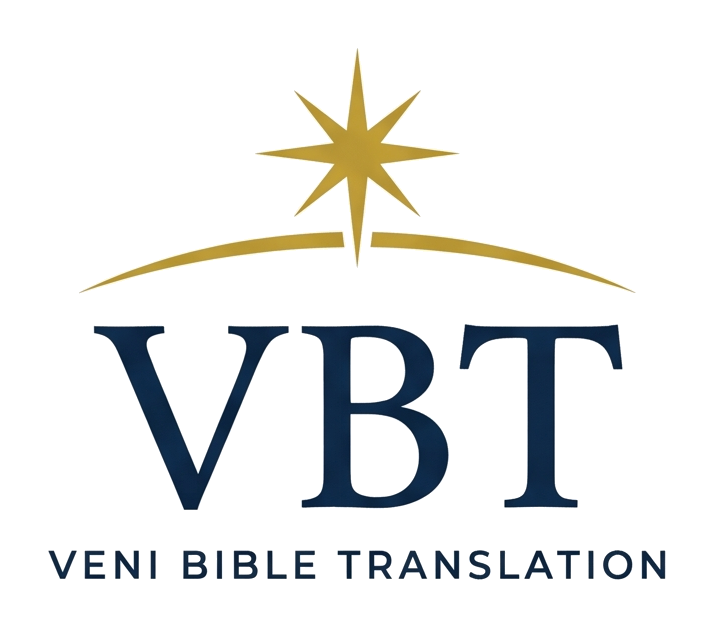

<p align="center">
  <picture>
    <source media="(prefers-color-scheme: dark)" srcset="assets/vbt-logo-dark.png">
    
  </picture>
</p>

<p align="center">
  <strong>A faithful, fluent and free translation of the Bible from the original languages.</strong><br>
  Brazilian Portuguese · English
</p>

<p align="center">
  <a href="pt-BR/revelation/markdown/README.md"></a>
  <a href="en/revelation/markdown/README.md"></a>
  
  
  <a href="LICENSE.md"></a>
  
</p>

---

> **Aquele que testemunha estas coisas diz: Sim, venho em breve. Amém. Vem, Senhor Jesus!**
> <br><sub>Apocalipse 22:20, VBT · *"He who testifies to these things says: Yes, I am coming soon. Amen. Come, Lord Jesus!"* (Revelation 22:20, VBT)</sub>

## Read

| Book | Language | Status | Read online | Download |
| --- | --- | --- | --- | --- |
| **Revelation** (Apocalipse) | Portuguese (pt-BR) | ✅ Translated · v25 | [Chapters 1–22](pt-BR/revelation/markdown/README.md) | [USFM](pt-BR/revelation/usfm/67-REV.usfm) · [JSON](pt-BR/revelation/json/revelation.json) · [TXT](pt-BR/revelation/txt/revelation.txt) |
| **Revelation** | English | ✅ Translated · v25 | [Chapters 1–22](en/revelation/markdown/README.md) | [USFM](en/revelation/usfm/67-REV.usfm) · [JSON](en/revelation/json/revelation.json) · [TXT](en/revelation/txt/revelation.txt) |
| Other books | pt-BR · English | 📖 Book by book, through the whole of Scripture | — | — |

## Why the VBT exists

Scripture should be freely available to everyone called to write a book, a devotional, a commentary, or anything that will bless others. The VBT began with a devotional on Revelation. Quoting all 404 verses of the book from an existing translation went beyond what its license allowed. Going on meant paying a fee and accepting limits on how far the material could travel. English has free, high-quality translations. Portuguese had none translated from today's critical Greek and Hebrew texts that was faithful, fluent and truly free.

That wall became a calling. The Veni Bible Translation exists so that anyone, whether a pastor preparing a study, a youth leader printing a handout, or a family reading at the table, can hold the Word in their own language, as close to the original as possible, without asking permission. The name comes from the Bible's last prayer: *Veni, Domine Iesu.* **Come, Lord Jesus.**

Every verse is translated from the Greek of the SBL Greek New Testament, and each decision is shown in the notes for anyone to check. Revelation is now complete in Portuguese and English, with 404 verses and 387 notes in each. The rest of Scripture will follow, book by book. And it is, and always will be, free for anyone, anywhere.

<sub>*Project led by Ismael Silva, who holds degrees in theology, has studied Koine Greek and Hebrew, and has more than 20 years of pastoral ministry on two continents.*</sub>

## Translation principles

- **Faithful.** A formal-equivalence translation of the original text, in the family of the ESV, NKJV and BSB. No content is added or removed; where the target language needs a word the Greek leaves implicit, the note says so.
- **Fluent.** Natural Brazilian Portuguese and English. The narrative "and" chains of the Greek are kept where they carry meaning (visions, series, lists, hymns) and lightened where they only slow the reader.
- **One translation, two languages.** The English is translated from the Greek, following the same decisions as the Portuguese verse by verse; the two editions carry the same notes.
- **Consistent.** Each key Greek term has one fixed rendering across the book, checked against a glossary — *santuário* / *sanctuary* for ναός, *tabernáculo* / *tabernacle* for σκηνή, *besta* / *beast* for θηρίον, *testemunho* / *testimony* for μαρτυρία.
- **Transparent.** 387 footnotes in each language show word choices, literal readings, textual variants (Sinaiticus, Alexandrinus, Byzantine text, Textus Receptus), alternative readings and Old Testament allusions, with Hebrew and Septuagint numbering where they differ.
- **Reverent.** Capital letters for the pronouns and titles of God, Christ and the Holy Spirit.
- **Traditional numbering.** 404 verses in Revelation, as in the ARA, NIV and BSB.

**Base texts.** New Testament: SBL Greek New Testament (SBLGNT). Old Testament: Westminster Leningrad Codex (WLC). Where the VBT departs from the base text, the note gives both readings and their witnesses.

## Formats

Each language folder (`pt-BR/`, `en/`) has the same four formats:

| Format | File | Best for |
| --- | --- | --- |
| Markdown | `revelation/markdown/` — [pt-BR](pt-BR/revelation/markdown/README.md) · [English](en/revelation/markdown/README.md) | Reading on GitHub, chapter by chapter, with notes |
| USFM 3.0 | `revelation/usfm/67-REV.usfm` — [pt-BR](pt-BR/revelation/usfm/67-REV.usfm) · [English](en/revelation/usfm/67-REV.usfm) | Bible software and publishing (Paratext, eBible, Bible apps); includes headings, poetry and footnotes |
| JSON | `revelation/json/revelation.json` — [pt-BR](pt-BR/revelation/json/revelation.json) · [English](en/revelation/json/revelation.json) | Developers and apps — chapters, headings, verses, notes and layout blocks (paragraphs and poetry lines) |
| Plain text | `revelation/txt/` — [pt-BR](pt-BR/revelation/txt/revelation.txt) · [English](en/revelation/txt/revelation.txt) | Search, quoting and quick reuse — one verse per line; notes in `revelation-notes.txt` |

## Using the VBT

The VBT text and notes are licensed under **[Creative Commons Attribution-NoDerivatives 4.0](https://creativecommons.org/licenses/by-nd/4.0/)**. You may copy, quote, print and share the text in any medium or format, including commercially, as long as:

1. the text is not changed, and
2. the source is credited.

**Short quotations:** *(Ap 1:3, VBT)* · *(Rev 1:3, VBT)*

**Credits page of other publications:**
> Scripture quotations from the Veni Bible Translation (VBT), © 2026 Ismael Silva, ismaelsilva.org. Used under the CC BY-ND 4.0 license.

The VBT logo, the VBT seal and the design of VBT editions are also free under CC BY-ND 4.0: share them as they are, without modification, and with credit. The name "Veni Bible Translation", the abbreviation VBT and the logo identify only the original text and may not be used for modified versions.

## Repository structure

```
veni-bible/
├── README.md
├── LICENSE.md
├── CHANGELOG.md
├── assets/                     logo (light and dark) and seal
├── pt-BR/
│   └── revelation/
│       ├── markdown/           22 chapters + index, with notes
│       ├── usfm/67-REV.usfm    full book, headings, poetry, footnotes
│       ├── json/revelation.json
│       └── txt/                one verse per line; notes
└── en/
    └── revelation/             same structure as pt-BR
```

## Corrections and suggestions

Found a typo or have a suggestion about a rendering? Please [open an issue](https://github.com/ismaelthesilva/veni-bible/issues) with the reference (for example, *Ap 13:3* or *Rev 13:3*) and your reasoning. Every change to the text is checked against the Greek, the glossary and the translation's decision log before a new version is released.

## The VBT seal

<p align="center">
  
</p>

<p align="center"><sub>
  <em>Veni, Domine Iesu</em> — "Come, Lord Jesus" (Revelation 22:20).<br>
  The morning star rising over the clouds (22:16; 1:7), Alpha and Omega (1:8; 22:13) and the golden lampstands (1:12).<br>
  The seal of the Veni Bible Translation, used on special editions.
</sub></p>

## Acknowledgements

The New Testament is translated from the **SBL Greek New Testament**, © 2010 Society of Biblical Literature and Logos Bible Software, licensed under [CC BY 4.0](https://creativecommons.org/licenses/by/4.0/).

---

<p align="center">
  <sub><em>Veni, Domine Iesu.</em> · © 2026 <a href="https://ismaelsilva.org">Ismael Silva</a></sub>
</p>
