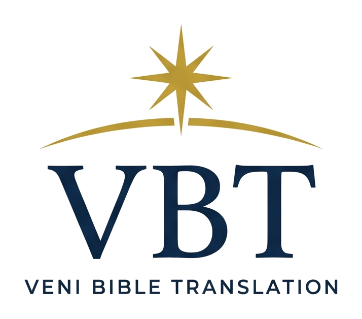

<p align="center">
  <picture>
    <source media="(prefers-color-scheme: dark)" srcset="assets/vbt-logo-dark.png">
    
  </picture>
</p>

<p align="center">
  <strong>A faithful, fluent and free translation of the Bible from the original languages.</strong><br>
  Brazilian Portuguese first · English to follow
</p>

<p align="center">
  <a href="pt-BR/revelation/markdown/README.md"></a>
  
  
  <a href="LICENSE.md"></a>
  
</p>

---

> **Aquele que testemunha estas coisas diz: Sim, venho em breve. Amém. Vem, Senhor Jesus!**
> <br><sub>Apocalipse 22:20, VBT · *"He who testifies to these things says: Yes, I am coming soon. Amen. Come, Lord Jesus!"*</sub>

## Read

| Book | Language | Status | Read online | Download |
| --- | --- | --- | --- | --- |
| **Revelation** (Apocalipse) | Portuguese (pt-BR) | ✅ Translated · v24.4 · in final language review | [Chapters 1–22](pt-BR/revelation/markdown/README.md) | [USFM](pt-BR/revelation/usfm/67-REV.usfm) · [JSON](pt-BR/revelation/json/revelation.json) · [TXT](pt-BR/revelation/txt/revelation.txt) |
| **Revelation** | English | 🔜 Planned | — | — |
| Other books | pt-BR · English | 📖 Book by book, through the whole of Scripture | — | — |

## Why the VBT exists

The VBT was born from a frustration many people know. While preparing a devotional, I quoted 404 verses from an existing translation — more than half of the permitted limit. To continue, I would have needed to pay for a license and accept restrictions that would limit how far the material could reach. In English, there are free, high-quality translations. In Portuguese, I could not find one translated from today's critical Greek and Hebrew texts that is faithful to the original, fluent to read, and truly free to use.

That obstacle became a calling. The Veni Bible Translation began with a simple desire: to read the Word as close to the original as possible — in Portuguese and English that are faithful, fluent and memorable. The name comes from the last prayer of the Bible: *Veni, Domine Iesu.* **Come, Lord Jesus.**

The work begins with Revelation and will follow, book by book, through the whole of Scripture. Each book comes with notes that show the choices made. And the translation is — and always will be — free for anyone, anywhere.

## Translation principles

- **Faithful.** A formal-equivalence translation of the original text, in the family of the ESV, NKJV and BSB. No content is added or removed; where Portuguese needs a word the Greek leaves implicit, the note says so.
- **Fluent.** Natural Brazilian Portuguese. The narrative "and" chains of the Greek are kept where they carry meaning (visions, series, lists, hymns) and lightened where they only slow the reader.
- **Consistent.** Each key Greek term has one fixed rendering across the book, checked automatically against a glossary — *santuário* for ναός, *tabernáculo* for σκηνή, *besta* for θηρίον, *testemunho* for μαρτυρία.
- **Transparent.** 383 footnotes show word choices, literal readings, textual variants (Sinaiticus, Alexandrinus, Byzantine text, Textus Receptus), alternative readings and Old Testament allusions.
- **Reverent.** Capital letters for the pronouns and titles of God, Christ and the Holy Spirit.
- **Traditional numbering.** 404 verses in Revelation, as in the ARA, NIV and BSB.

**Base texts.** New Testament: SBL Greek New Testament (SBLGNT). Old Testament: Westminster Leningrad Codex (WLC). Where the VBT departs from the base text, the note gives both readings and their witnesses.

## Formats

| Format | File | Best for |
| --- | --- | --- |
| Markdown | [`pt-BR/revelation/markdown/`](pt-BR/revelation/markdown/README.md) | Reading on GitHub, chapter by chapter, with notes |
| USFM 3.0 | [`67-REV.usfm`](pt-BR/revelation/usfm/67-REV.usfm) | Bible software and publishing (Paratext, eBible, Bible apps); includes headings, poetry and footnotes |
| JSON | [`revelation.json`](pt-BR/revelation/json/revelation.json) | Developers and apps — chapters, headings, verses and notes |
| Plain text | [`revelation.txt`](pt-BR/revelation/txt/revelation.txt) · [`revelation-notes.txt`](pt-BR/revelation/txt/revelation-notes.txt) | Search, quoting and quick reuse — one verse per line |

## Using the VBT

The VBT text and notes are licensed under **[Creative Commons Attribution-NoDerivatives 4.0](https://creativecommons.org/licenses/by-nd/4.0/)**. You may copy, quote, print and share the text in any medium or format, including commercially, as long as:

1. the text is not changed, and
2. the source is credited.

**Short quotations:** *(Ap 1:3, VBT)*

**Credits page of other publications:**
> Scripture quotations from the Veni Bible Translation (VBT), © 2026 Ismael Silva, ismaelsilva.org. Used under the CC BY-ND 4.0 license.

The name "Veni Bible Translation" and the abbreviation VBT identify only the original text and may not be used for modified versions. The license does not cover the logo or the design of printed editions.

## Repository structure

```
veni-bible/
├── README.md
├── LICENSE.md
├── CHANGELOG.md
├── assets/                     logo (light and dark)
└── pt-BR/
    └── revelation/
        ├── markdown/           22 chapters + index, with notes
        ├── usfm/67-REV.usfm    full book, headings, poetry, footnotes
        ├── json/revelation.json
        └── txt/                one verse per line; notes
```

## Corrections and suggestions

Found a typo or have a suggestion about a rendering? Please [open an issue](https://github.com/ismaelthesilva/veni-bible/issues) with the reference (for example, *Ap 13:3*) and your reasoning. Every change to the text is checked against the Greek, the glossary and the translation's decision log before a new version is released.

## Acknowledgements

The New Testament is translated from the **SBL Greek New Testament**, © 2010 Society of Biblical Literature and Logos Bible Software, licensed under [CC BY 4.0](https://creativecommons.org/licenses/by/4.0/).

---

<p align="center">
  <sub><em>Veni, Domine Iesu.</em> · © 2026 <a href="https://ismaelsilva.org">Ismael Silva</a></sub>
</p>
